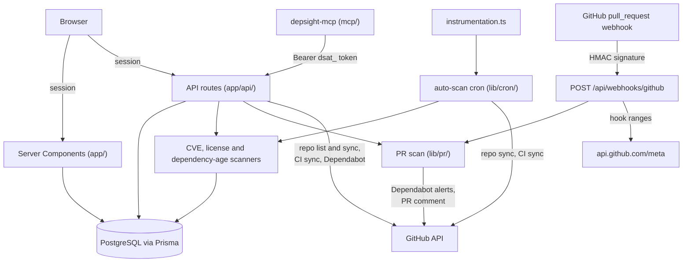
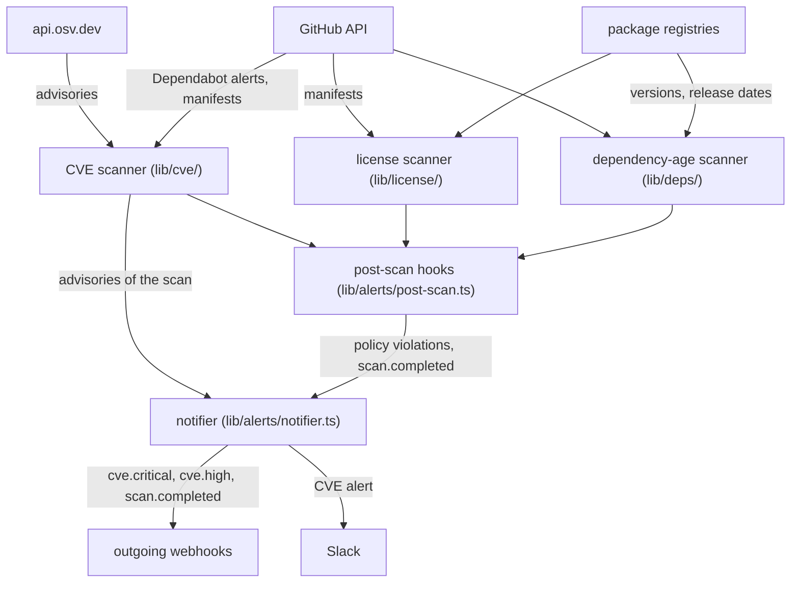

# Architecture

depsight is a full-stack Next.js application with the App Router, backed by PostgreSQL via Prisma, and shipped as a Docker image (multi-stage build).

## Tech stack

- **Framework:** Next.js 15 (App Router)
- **Language:** TypeScript (strict mode)
- **Database:** PostgreSQL 16 + Prisma ORM
- **Styling:** Tailwind CSS 4
- **Auth:** NextAuth v5 beta (GitHub OAuth; Dev Credentials in development builds only)
- **Deployment:** Docker (multi-stage build)

## Layers

| Layer | Location | Purpose |
|-------|----------|---------|
| Pages | `app/` | Route handlers (Server Components) |
| API | `app/api/` | REST endpoints |
| Components | `components/` | Reusable UI |
| Library | `lib/` | Business logic, auth, utilities |
| Database | `prisma/` | Schema (managed via `prisma db push`; no migrations directory) |

## Project structure

```
app/
  api/              API routes (auth, scan, license, deps, sbom, ...)
  dashboard/        Main dashboard (repo list, CVE/license/deps tabs)
  overview/         Team health overview + repo comparison
  policies/         Policy management
  settings/         Settings (UI language, API tokens, outgoing webhooks, Slack, PR scan webhook secrets)
  login/            Login page
components/         Shared UI components
lib/                Business logic (illustrative selection below)
  cve/              CVE scanner
  deps/             Dependency age scanners (npm, python, go, java, rust, php)
  license/          License scanners (npm, python, go, java, rust, php)
  sbom/             CycloneDX SBOM generator
  policy/           Policy engine
  overview/         Team health aggregation
  cron/             Scheduled auto-scan
  export/           Repository export bundle
  pr/               PR scan and webhook security
  alerts/           Notifications (outgoing webhooks, Slack)
  scan/             Per-scanner freshness and degraded runs
  ci/               GitHub Actions sync and CI analytics
prisma/             Database schema
docker/             Docker entrypoints
mcp/                MCP server (separate npm package)
scripts/            Token minting, CI helpers
```

## Data flow

depsight has four entry points: the browser (Server Components and API routes under a NextAuth session), the MCP server (API routes with a `dsat_` Bearer token), GitHub's `pull_request` webhook (`POST /api/webhooks/github`, verified by a per-repository HMAC secret) and the auto-scan cron, which `instrumentation.ts` starts with the server. The cron syncs every user's repositories and CI runs and runs the three scanners for repositories that are due; API routes run the same scanners on demand. The PR scan (started by the webhook or by `POST /api/pr-scan`) reads Dependabot alerts and posts the PR comment. Everything is stored in PostgreSQL through Prisma.

The first diagram shows the entry points and what each one calls:



The second diagram shows what the scanners read and where their results are sent. The CVE scanner reads Dependabot alerts and manifests from GitHub and queries OSV; the license and dependency-age scanners read manifests from GitHub and look packages up in the package registries. After a CVE scan the notifier sends the scan's CRITICAL and HIGH advisories to outgoing webhooks (`cve.critical`, `cve.high`) and posts to Slack when the configured minimum severity is reached. After every scan the post-scan hooks evaluate the user's policies and send `scan.completed`.



Credentials per external system:

- **GitHub API:** the stored GitHub OAuth token of the user who tracks the repository (for an API route, the signed-in or token-holding user; for the cron, each user in turn; for the PR scan webhook, the user whose secret verified the delivery).
- **api.osv.dev and the package registries:** none.
- **MCP server to depsight:** a `dsat_` Bearer token.
- **GitHub webhook to depsight:** the per-repository HMAC secret, see [GitHub pull-request webhook](api.md#github-pull-request-webhook).

The hosts the app needs outbound access to are listed in [Network access](configuration.md#network-access).

## Security model

- **GitHub sign-in** requests the scopes `repo`, `user:email` and `read:org` (`lib/auth.ts`). `repo` is needed to read manifests and Dependabot alerts of private repositories, post PR scan comments and enable Dependabot alerts.
- **Credentials at rest:**
  - GitHub OAuth token (`User.githubToken`): stored in plaintext, written at every sign-in. The auto-scan cron uses it for every user who has one (`lib/cron/auto-scan.ts`).
  - `dsat_` API tokens (`ApiToken.token`): stored as-is and matched by value on every request (`lib/auth-api.ts`). They never expire; a token is revoked in Settings or with `DELETE /api/tokens/[id]`.
  - PR scan webhook secrets (`Repo.webhookSecretEnc`): sealed with AES-256-GCM under a key derived from `WEBHOOK_SECRET_KEY`, or from `NEXTAUTH_SECRET` when that is unset (`lib/pr/webhook-secret.ts`).
  - Outgoing webhook signing secrets (`WebhookConfig.secret`): stored in plaintext. `GET /api/webhooks` leaves them out; `POST /api/webhooks` and `PATCH /api/webhooks/[id]` answer with the full row, secret included.
- **API token scopes:** a `dsat_` token carries `READ` or `WRITE` (see [API reference](api.md)). Token management (`/api/tokens`) is session-only, so a token cannot mint, list or revoke tokens.
- **Per-user data:** repositories, scans, policies, tokens, webhooks and Slack settings belong to one user, and the routes look them up by the caller's user id (for example `evaluatePolicies` in `lib/policy/engine.ts`). There are no teams or roles.
- **Outgoing URLs:** outgoing webhook and Slack URLs must be public `http(s)` targets. They are checked when they are saved and again at every delivery (`lib/net/safe-fetch.ts`).
- **Dev Login:** a development build (`NODE_ENV=development`) adds a Dev Login that signs anyone in as any username without a password and creates that user. A development instance must therefore never be reachable from outside.
