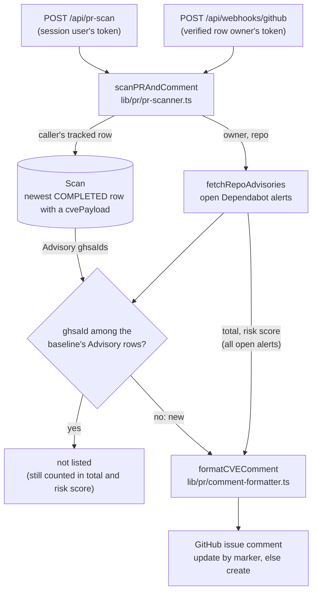

`docs/configuration.md` ("What the PR scan compares") and `docs/api.md` describe the PR scan for users. This doc traces the mechanism across the files that produce it, and the cases where it has no baseline at all.

## Two entry points, one function

Both entry points call `scanPRAndComment(accessToken, owner, repo, prNumber, userId)` in `lib/pr/pr-scanner.ts`.

- `POST /api/pr-scan` is session-only (`app/api/pr-scan/route.ts:17-21#"return NextResponse.json({ error: 'Unauthorized' }, { status: 401 });"`). It passes the signed-in user's stored GitHub token and user id (`app/api/pr-scan/route.ts:43-48#"session.user.id,"`), waits for the result and answers `500` with the error message when the scan throws (`app/api/pr-scan/route.ts:55-57#"return NextResponse.json({ error: message }, { status: 500 });"`).
- `POST /api/webhooks/github` acts for the oldest tracking row whose secret verifies the delivery (`app/api/webhooks/github/route.ts:348-356#"orderBy: { createdAt: 'asc' },"`, `app/api/webhooks/github/route.ts:383-384#"if (!tracked) return invalidSignature();"`), only for the `opened` and `synchronize` actions (`app/api/webhooks/github/route.ts:37#"const SCAN_ACTIONS = new Set(['opened', 'synchronize']);"`). After the fork rule, the replay guard and the rate limits it starts the scan with that row owner's GitHub token without awaiting it and answers `202` (`app/api/webhooks/github/route.ts:444-458#"return NextResponse.json({ ok: true, accepted: true }, { status: 202 });"`). A failed scan is only logged, and its replay keys are released so GitHub can redeliver (`app/api/webhooks/github/route.ts:450-453#"prWebhookDeliveries.forget(bodyKey);"`).

The flowchart below shows what one PR scan reads and writes.

## What is compared

The current side is the repository's open Dependabot alerts, read through `fetchRepoAdvisories` (`lib/pr/pr-scanner.ts:24#"const scanResult = await fetchRepoAdvisories(accessToken, owner, repo);"`), which pages through `listAlertsForRepo` with `state: 'open'` (`lib/cve/github-advisories.ts:92-96#"state: 'open',"`). The module imports no OSV code (`lib/pr/pr-scanner.ts:1-5#"import { formatCVEComment } from './comment-formatter';"`), so the OSV channel of the CVE scan takes no part. The function calls no pull request endpoint either: the pull request number only selects where the comment goes, so neither the diff nor the head commit is read.

The baseline is the caller's tracked row of the repository (`lib/pr/pr-scanner.ts:19-20#"where: { owner, name: repo, userId, tracked: true },"`) and its newest `Scan` row with status `COMPLETED` and a `cvePayload` (the same filter `GET /api/scan` and `GET /api/history` use), ordered by `scannedAt` (`lib/pr/pr-scanner.ts:29-38#"include: { advisories: { select: { ghsaId: true } } },"`). An alert counts as new when its `ghsaId` is not among that row's Advisory rows (`lib/pr/pr-scanner.ts:46-47#"(a) => !previousGhsaIds.has(a.ghsaId),"`). The match is on the GHSA id alone, not on the package.

Consequences that follow from the code:

- **Only a CVE scan is a baseline.** The query carries `cvePayload: { not: Prisma.DbNull }`, as `GET /api/scan` does when it picks the latest CVE scan (`app/api/scan/route.ts:68-76#"orderBy: { scannedAt: 'desc' },"`). The license and dependency scanners write `Scan` rows too (`lib/license/scanner.ts:18-20#"data: { repoId, status: 'RUNNING' },"`, `lib/deps/scanner.ts:26-37#"data: { repoId, status: 'RUNNING' },"`) and attach no Advisory rows to them, so a newer completed license or dependency scan no longer hides the last CVE scan's advisories. The cron starts all three scanners together for each due repository (`lib/cron/auto-scan.ts:118-121#"scanDependencies(user.id, repo.id, user.githubToken),"`), and the dependency scan's row normally carries the latest `scannedAt` after a cycle, which is why the filter matters.
- **No tracked row or no CVE scan, no baseline.** When the caller tracks no row for the repository, or no completed CVE scan exists, `previousGhsaIds` stays empty and every open alert is new. `POST /api/pr-scan` does not check tracking before it scans.
- **Nothing is stored.** The PR scan writes no `Scan` or `Advisory` row, so repeated PR scans compare against the same baseline until another scan of the repository completes. An alert that is not in that baseline is listed on every pull request scanned until then.
- **Dependabot off reads as "no new CVEs".** A `404` or a `403` that is not a rate limit returns an empty result flagged `dependabotDisabled` (`lib/cve/github-advisories.ts:127-129#"return { ...buildScanResult([]), dependabotDisabled: true };"`). `scanPRAndComment` ignores the flag, so the comment states that there are no new CVEs against the last CVE scan, with a risk score of 0 and a total of 0 (`lib/pr/comment-formatter.ts:9-10#"Keine neuen CVEs"`). A rate-limited `403` is rethrown (`lib/cve/github-advisories.ts:124-125#"throw error; // transient"`) and fails the PR scan.

## Totals and risk score in the comment

The comment's total and risk score are those of the raw Dependabot alert list (`lib/pr/pr-scanner.ts:82-83#"scanResult.riskScore,"`). The CVE scan stores values computed after merging the OSV channel and collapsing repeated Dependabot alerts for one advisory and package, so the two can differ in both directions; see [CVE channel merge and scores](cve-channel-merge-and-scores.md). The listed new alerts are not collapsed either: one advisory raised for the same package in two manifests is listed twice.

## Comment upkeep

The comment body starts with the marker `<!-- depsight-cve-scan -->` (`lib/pr/pr-scanner.ts:7#"const DEPSIGHT_COMMENT_MARKER = '<!-- depsight-cve-scan -->';"`). The scan reads the pull request's first 100 comments, with no further pages (`lib/pr/pr-scanner.ts:53-57#"per_page: 100,"`), and updates the first one that contains the marker; otherwise it creates a new comment (`lib/pr/pr-scanner.ts:88-109#"console.error('Failed to post PR comment:', err);"`). A failure to list comments is ignored, so the scan then creates a new comment (`lib/pr/pr-scanner.ts:51-62#"// Can't read comments, proceed anyway"`). A failure to post is logged and returned as `commented: false` with `commentUrl: null` (`lib/pr/pr-scanner.ts:113-116#"commentUrl,"`).

The comment text is German. It lists at most ten new alerts; the overflow line after them ("... und N weitere CVEs.") carries no link, because the comment code has no instance base URL to link to (`lib/pr/comment-formatter.ts:55-57#"weitere CVEs._"`). The comment words its result relative to the last CVE scan and does not attribute alerts to the pull request. The footer date is formatted for the `de-DE` locale (`lib/pr/comment-formatter.ts:60#"toLocaleDateString('de-DE')"`).
